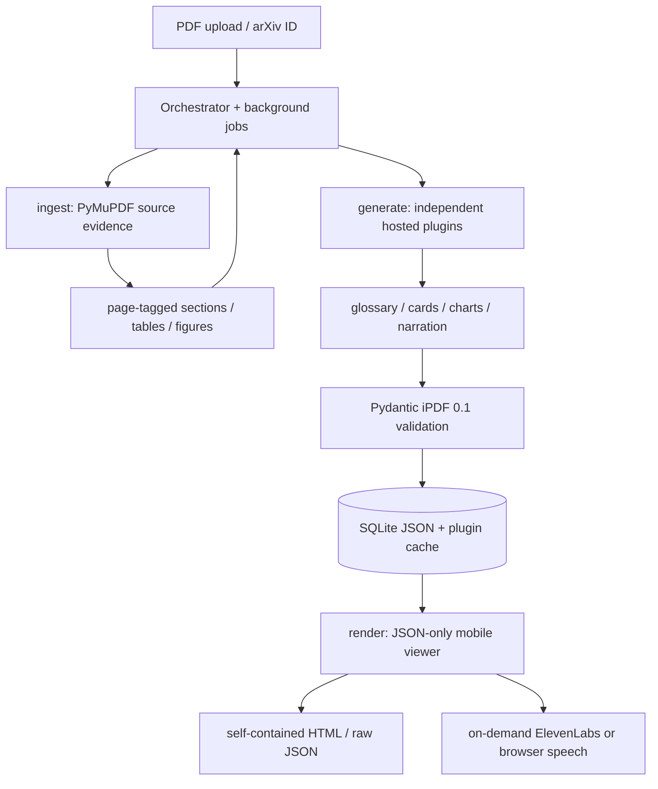

# iPDF

**Read it. Question it. Take it with you.** An open, versioned JSON format for
interactive research papers, plus a viewer designed for a 390 px phone screen.

The source paper stays the main content. Generation adds page-linked glossary
entries, study cards, charts backed by original table cells, and section narration.
It does **not** replace the paper with a summary.

Python 3.11 · FastAPI · Pydantic · PyMuPDF · Jinja2 · stdlib SQLite · vanilla JS ·
vendored Chart.js. All inference uses a **hosted OpenAI-compatible endpoint**.
No GPU, model download, account system, or JavaScript framework is required.

## Run

**Public static reader:** [blackfang007.github.io/ipdf](https://blackfang007.github.io/ipdf/).
Open an exported `.ipdf.json` file or explore the authored welcome demo. Files are
read in the browser. GitHub Pages cannot run FastAPI, PDF ingestion or hosted
generation; use the full app below for those features. API keys stay server-side.

To rebuild the Pages viewer after changing render code, run
`python scripts/build_pages.py` and commit `docs/`. Pages publishes `main:/docs`.

```sh
python3.11 -m venv .venv
source .venv/bin/activate              # Windows: .venv\Scripts\Activate.ps1
pip install -r requirements.txt
cp .env.example .env                  # Windows: Copy-Item .env.example .env
# Set LLM_API_KEY and LLM_MODEL in .env. Do not commit this file.
uvicorn app.main:app --host 127.0.0.1 --port 8000
```

Open [iPDF](http://127.0.0.1:8000). Upload a text-based PDF or enter an arXiv ID
(e.g. `1706.03762`), then choose beginner/intermediate/expert. Creation returns a
job ID immediately; the page polls progress while extraction and generation run
in background threads. Restart the app after changing `.env`.

Without provider credentials, the app still boots and produces an explicitly
labelled **source-only edition** with original pages and exports. It does not
invent learning blocks. Configure the model and submit the paper again to create
the annotated edition under a different cache identity.

For a phone on the same network, bind `--host 0.0.0.0` and open
`http://YOUR_LAPTOP_LAN_IP:8000` on the phone. Allow the port through your laptop's
firewall if needed. Use an HTTPS host for normal remote/mobile access.

## Hosted configuration

| Variable | Default / requirement |
|---|---|
| `LLM_BASE_URL` | `https://router.huggingface.co/v1` |
| `LLM_API_KEY` | **Required for generation**, no default |
| `LLM_MODEL` | **Required for generation**, no hardcoded model |
| `DEEP_BASE_URL`, `DEEP_API_KEY`, `DEEP_MODEL` | Optional Ultramarine; all three must be set, otherwise use `LLM_*` |
| `TTS_PROVIDER` | `browser` (default) or `elevenlabs` |
| `ELEVENLABS_API_KEY`, `ELEVENLABS_VOICE_ID` | Optional hosted speech credentials |
| `ELEVENLABS_MODEL` | `eleven_flash_v2_5` |
| `FAST_PRICE_IN`, `FAST_PRICE_OUT` | USD / million input and output tokens (`PRICE_IN/PRICE_OUT` aliases supported) |
| `DEEP_PRICE_IN`, `DEEP_PRICE_OUT` | USD / million tokens for optional DEEP |
| `TTS_PRICE_PER_1K_CHARS` | USD / 1,000 ElevenLabs characters |
| `LLM_TIMEOUT`, `LLM_MAX_TOKENS` | 90 seconds / 3,500 output tokens |
| `LLM_RATE_LIMIT_MAX_WAIT` | 60 seconds; respect shorter provider retry delays and stop on longer resets |
| `DATA_DIR` | `data/`: SQLite, source PDFs, jobs, provider audio and caches |
| `MAX_PDF_PAGES` | 80; uploads also limited to 25 MB |
| `MAX_GENERATION_SECTIONS` | 20; explicit processing limit, with a visible issue when a paper is longer |
| `PORT` | 8000; the Docker startup command honors the host's `$PORT` |

Choose an available chat model and exact provider-qualified identifier from
[Hugging Face Inference Providers](https://huggingface.co/docs/inference-providers/tasks/chat-completion),
or set another hosted compatible endpoint. The app uses the OpenAI Python SDK;
it does not require an OpenAI account. Ultramarine's endpoint/model are supplied
entirely through `DEEP_*`; no endpoint or model name is embedded in the code.

Optional DEEP handles chart table selection and claim grounding. FAST handles
glossary, cards and narration. Incomplete DEEP configuration uses FAST. DEEP
transport failures retry and fall back to FAST; schema-invalid outputs are dropped
after at most two retries. Actual provider/model metadata accompanies each block.
Keys remain on the server and are absent from JSON/HTML exports.

## Three layers



`app/ingest/`, `app/generate/`, and `app/render/` do not import or call one another.
`app/orchestrate.py` coordinates them. The renderer consumes validated iPDF JSON
only; it cannot invoke an LLM. Shared services are `llm.py`, `extract.py`, `db.py`
and `audio.py`. The original LazyDigest source is preserved, unmounted, under
`app/modules/digest/`, with its original tests and UI.

## The open format

See [SPEC.md](SPEC.md), [ipdf.schema.json](ipdf.schema.json) and
`app/schema.py`. Version is exactly `"ipdf_version": "0.1"`.

Every generated block stores its source page, plugin, prompt version and actual
model name. Section references and page bounds are validated. Level changes
glossary depth, question difficulty and narration style. Cache identity includes
paper content hash, level, FAST/DEEP models and prompt versions. Validated plugin
outputs are reused without new provider calls.

Chart plans contain **row/column indices, never model-generated values**. Values
are parsed from the PDF's extracted table grid and independently rechecked by
the document validator. Captions link to `from Table N, p.X`. Ambiguous grids,
fragmented decimals, uncertainty pairs and unreadable numeric cells are omitted.
Extraction may therefore omit usable tables; it favors source traceability over
filling the page with charts. Raster figures are extracted as images; vector-only
figures may be absent. Scanned/encrypted PDFs are rejected with an actionable
message; OCR is outside this version.

## Reading, studying and walking

- Original sections stay in page order. Tap an underlined term for a popover;
  desktop hover also exposes its definition. Save cards to a browser-local deck.
- Study-card answers expand in place. Chart values have an inspectable table.
  Every learning block links to the corresponding original PDF page.
- Top play reads narration in source order, highlights and scrolls to the current
  section, and supports previous/next and 0.75×–1.5× speed.
- Walking mode offers large controls and **“A little simpler, please”**, which
  replays the already-generated `simpler_script` for the current section. This
  action never invokes generation.
- Media Session handlers provide play/pause/track controls where supported.
  Reliable phone lock-screen/background behavior depends on the browser and OS;
  hosted MP3 playback generally has broader support than browser speech. No
  physical-phone lock-screen test has been claimed.
- ElevenLabs uses its plain
  [text-to-speech REST API](https://elevenlabs.io/docs/api-reference/text-to-speech/convert).
  Audio is requested only on demand, generated in a background job, and cached by
  script + voice + model. Missing keys, quota, authentication and network errors
  switch to `window.speechSynthesis` and display the fallback. Browser voices vary
  by device and may themselves use the device vendor's speech service.

## Portable exports

**Interactive HTML** contains the validated JSON, CSS, JavaScript, vendored
Chart.js, original PDF bytes, extracted images, and any already-cached hosted
audio. It has no CDN dependency. It can be opened independently of this app.
Unrequested audio is not synthesized during export; browser speech remains the
fallback. Device speech availability determines offline narration support.

**Raw JSON** is the versioned format for other viewers/tools. It includes source
URLs and generated scripts; it does not automatically embed source PDF bytes or
uncached audio. Raw server-relative links require the originating server. HTML
exports embed the source PDF and turn its page links into a local Blob URL.

Study decks live in localStorage on the current browser; exports include learning
blocks, not the reader's browser-local saved/deleted deck state.

## Free hosting / Docker

```sh
docker compose up --build
# Or:
docker build -t ipdf .
docker run --env-file .env -e PORT=8000 -p 8000:8000 -v "$PWD/data:/app/data" ipdf
```

The container contains one FastAPI app. It downloads no inference weights and
requires no GPU or speech runtime. `render.yaml` is a Render Blueprint using the
free web-service plan: connect this repo, select the Blueprint, and enter
`LLM_API_KEY` and `LLM_MODEL` in Render's environment settings. Its Docker command
binds to `0.0.0.0:$PORT`; `/health` needs no provider calls.

Render's free service has an
[ephemeral filesystem and spins down when idle](https://render.com/docs/free).
SQLite, uploads and generated audio are therefore temporary there. Export the
`.ipdf.html` file to retain a paper; use a persistent volume on a host that offers
one for durable server storage. Running jobs can be interrupted by restarts; the
status endpoint then reports an interrupted job rather than hanging forever.
This repo is deployment-ready configuration, **not a claim that a public host
was deployed or Docker images were run**. There is no authentication: documents
are accessible to anyone who has their URL. Do not use a public instance for
private papers without adding access control.

## API

| Route | Result |
|---|---|
| `POST /ipdf/create` | Multipart `pdf` **or** `arxiv_id`, `level`; HTTP 202 + `job_id` |
| `GET /ipdf/status/{job}` | Persistent queued/running/ready/error state, progress and result |
| `GET /ipdf/{id}` | Mobile viewer |
| `GET /ipdf/{id}.json` | Validated raw JSON download |
| `GET /ipdf/{id}/export` | Self-contained `.ipdf.html` download |
| `POST /audio/{id}/{section}?simpler=true` | HTTP 202 + audio job; synthesis only, no LLM |
| `GET /media/papers/{hash}.pdf` | Stored original PDF |
| `GET /media/audio/{hash}.mp3` | Cached hosted audio |
| `GET /health`, `GET /spec` | App readiness / human-readable specification |

Create/audio return quickly; extraction and remote provider work run in a bounded
two-thread job pool. Job status is persisted in SQLite. Eight pending/running
jobs are allowed at once. Source files are capped at 25 MB.

## Checks and real-paper runs

```sh
pytest -q                                  # mocked clients only, no model/key needed
python scripts/validate_ingest.py           # three real arXiv PDFs, page/table evidence
python scripts/validate_chart_evidence.py   # deterministic source-cell checks, no LLM
python scripts/validate_hosted.py           # REAL hosted output: one paper, all 3 levels
python scripts/validate_hosted.py --max-sections 1  # explicit smaller hosted smoke test
python scripts/validate_e2e.py              # running HTTP app, 3 real PDFs, view + exports
```

Real validation artifacts are in ignored `data/validation/`; the portable account
of what was actually checked is [VALIDATION.md](VALIDATION.md). The UI fixture
script creates an explicitly labelled mocked document for interaction QA. It is
never counted as hosted generation evidence.

## Why open models

iPDF is independent of a model vendor. Hosted open-weight models can be swapped
by changing `LLM_BASE_URL`, `LLM_API_KEY`, and `LLM_MODEL`, without changing the
format, viewer, prompts' version metadata, or the ingest pipeline. The application
can be self-hosted on an ordinary CPU laptop or web server while inference stays
at the configured hosted provider. Open JSON and self-contained HTML let the
paper outlive a particular service. The source code and schema remain inspectable.

### Cost per paper

Actual token counts and configured dollar costs are recorded per job and included
in JSON provenance. Cached generation adds no provider usage. Set actual rates
before measuring costs; **zero/unset prices do not mean free hosted generation**.

| Real paper | Pages | Source-only HTTP run | Hosted generation cost |
|---|---:|---:|---|
| Attention Is All You Need | 15 | 5.86 s | Full-paper cost not measured |
| BERT | 16 | 6.06 s | Full-paper cost not measured |
| Deep Residual Learning | 12 | 7.11 s | Full-paper cost not measured |

These runs made no LLM requests and are not AI-quality benchmarks. For a measured
hosted run, cost = `(input_tokens × input_rate + output_tokens × output_rate) / 1e6`,
plus optional ElevenLabs characters × `TTS_PRICE_PER_1K_CHARS / 1000`. Grounding and
validation retries are included in recorded token use. Provider billing remains
the authoritative amount. No made-up Ultramarine or ElevenLabs bill is reported.

Subsequent small live checks passed for Groq, Ultramarine and ElevenLabs. A
FAST-only generation attempt produced five grounded glossary entries but hit
Groq's rate limit before the three-level pipeline completed. See
[VALIDATION.md](VALIDATION.md) for the limits of that check. Browser speech stays
the default; ElevenLabs is opt-in and synthesizes only requested segments.

## Roadmap

- Better column/heading reconstruction and vector-figure extraction.
- A format conformance suite and independent JSON import/viewer.
- Optional persistent object storage for free-host deployments.
- Physical Android/iOS background and lock-screen playback checks.
- Optional authentication for private/shared deployments; bibliography links.
- Spaced repetition and portable personal study decks.

## Community Wisdom

[Na'aman Hirschfeld's validation-retry account](https://dev.to/nhirschfeld/when-an-llm-response-fails-validation-feed-the-error-back-into-the-retry-2e1e)
describes returning the validation error and rejected payload to the next attempt.
Commenters also distinguish formatting repair from repeated semantic mistakes.
iPDF uses bounded repair plus separate grounding and numeric-evidence checks.
[Peter Ndumia's PDF extraction account](https://dev.to/peter_ndumia_pdfhaul/why-extracting-tables-from-a-pdf-is-harder-than-it-looks-and-how-we-actually-do-it-2llg)
describes rejecting false table grids before downstream use. These are two
implementation accounts, not a claim of broad community consensus.
